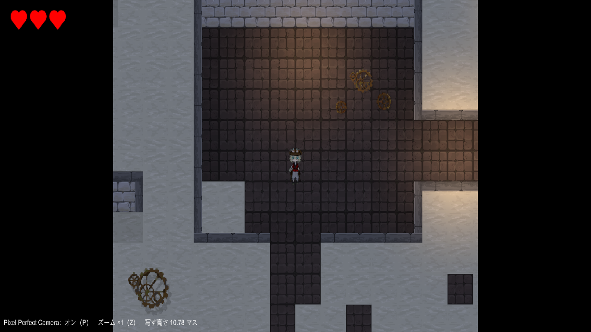
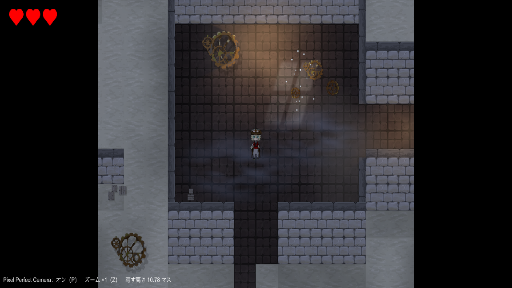
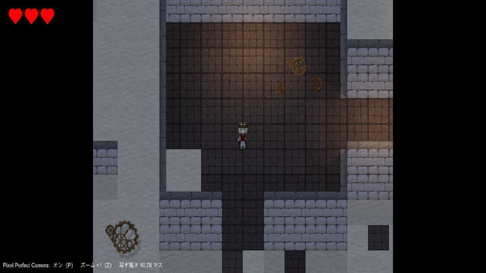
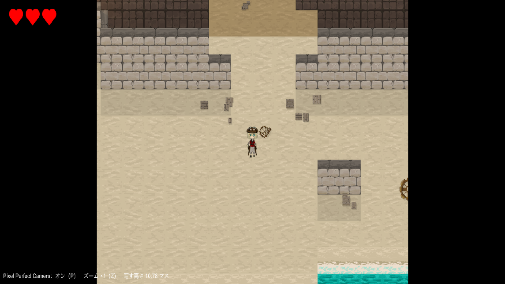
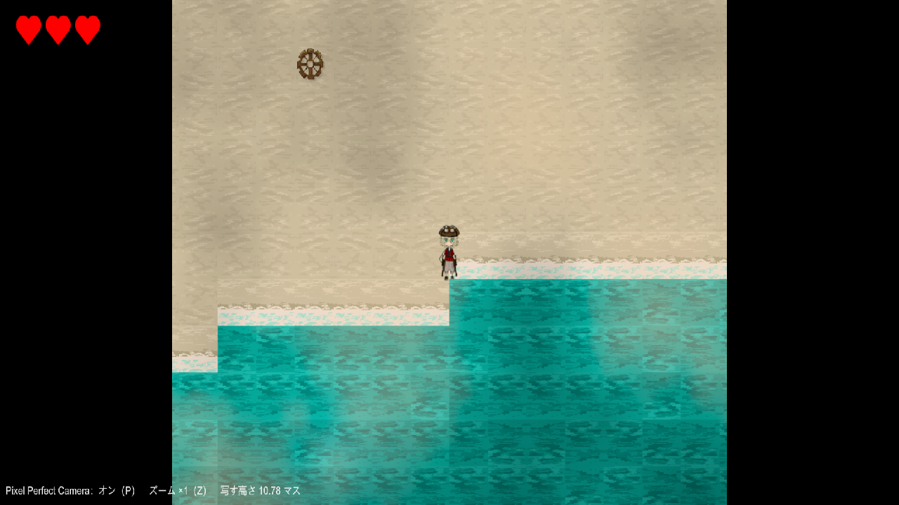
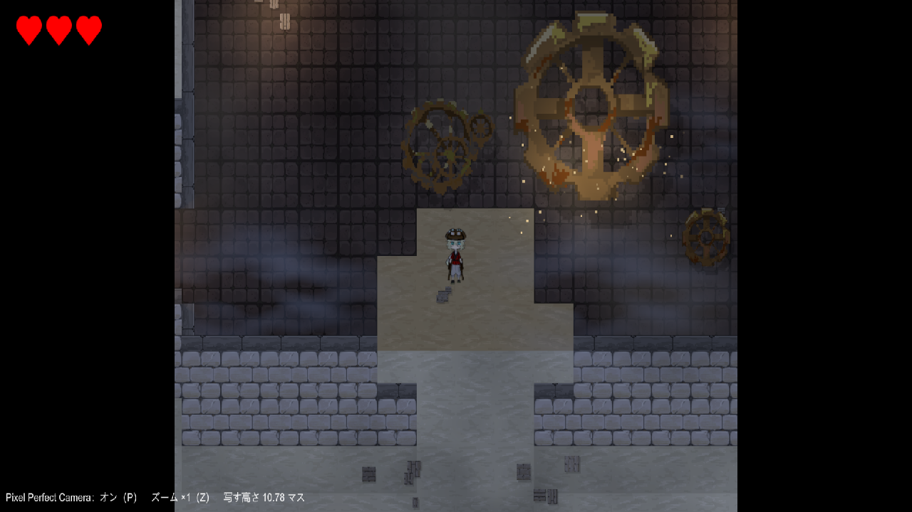

# マップチップ素材のお願い（作る人へ。2026-11-27）

試し配置マップ（`Test_Mapchip` の「浜辺と遺跡」）で、今のマップチップ 8 枚だけを使って見た目を良くしました（`Docs/マップの見た目の向上プラン.md` の段階 1〜5）。
配置・光・霧などで直せる所は直しました。ここに書くのは、**絵がないと直せない所**です。
素材チェックリスト（`Docs/素材チェックリスト.xlsx`）の **MAP-12〜19** に同じ内容の行があります。

前と後：

| 段階 1 の前 | 段階 5 の後 |
|---|---|
|  |  |

---

## 優先度 A

### MAP-12　壁の上面の 9 枚
- **今**：壁を上から見た縁（`Kabe.2`）を回して使っています。角は 2 枚を重ねて L 字にしているので、角の所で縁が重なったり、内側の角（廊下と部屋のつなぎ目など）がつながらなかったりします。
- **ほしい物**：上面の縁の **四隅（外の角）4・上下左右の辺 4・内側の角 1**（内側の角は回して 4 方向に使います）。縁の太さは今の `Kabe.2` と同じ（約 21px）。
- 形式：64×64px・PPU 64・透過 PNG。

## 優先度 B

### MAP-13　壁の面の下の端
- **今**：壁の面（`Kabe.1`）の下に半透明の黒い四角を重ねて影にしています。
- **ほしい物**：壁の面の一番下の段用に、床とつながる所に影・すすけた色が入った絵。

### MAP-14　床・砂の違う柄 2〜3 枚
- **今**：`Yuka.1`・`Suna.1` を場所ごとに反転させて変化をつけています。広い所では同じ模様がまだわかります。
- **ほしい物**：同じ色で、ひび・欠け・小石などが入った柄違い 2〜3 枚。元の絵と端がつながること。届いたら Rule Tile のランダムに混ぜます。

### MAP-15　がれき・小石・草・岩などの小物
- **今**：壁の絵（`Kabe.1`）を小さくした四角を、がれきの代わりに置いています。四角いボタンのように見えます。
- **ほしい物**：8〜24px くらいの小物 3〜5 種類（がれき・小石・草・岩）。透過 PNG。

### MAP-16　砂の色をそろえる（`Umi.2` と `Suna.1`）
- **今**：波打ち際のチップ `Umi.2` の砂の部分が `Suna.1` より明るく、波打ち際の上に色の帯が見えます。
- **ほしい物**：`Umi.2` の砂の色を `Suna.1` に合わせた絵（大きさはそのまま）。

### MAP-17　波打ち際の角（外側・内側）
- **今**：海岸線が曲がる所は「海が下」の絵で代用していて、角がつながりません。
- **ほしい物**：外側の角 1・内側の角 1（回して 4 方向に使います）。

## 優先度 C（あると質が上がる）

### MAP-18　動く海・水面（2〜4 コマ）
- 海・波打ち際を 2〜4 コマで動かす絵。届いたら Animated Tile で動かします（今は水面のきらめきの明かりだけで動きを出しています）。

### MAP-19　見せ場の物の凹凸の絵（法線マップ）
- 大きな歯車など、見せ場の物にだけ、明かりで凹凸が出るための絵。手描きか、Laigter などの作るツールで。元の絵と 1 画素もずらさないこと。

---

## 届いたらすること（プログラム側）
- 絵を `Assets/Images/Mapchip/` に置く → `Tools > Mapchip > Fix Seams`（継ぎ目の対策）→ タイルとパレットに足す（レシピ `mapchip_tiles`）。
- 試し配置マップを作り直す（レシピ `mapchip_beach`）：角・下の端・柄違い・小物を差し替え、仮の物（重ねた角・黒い四角・小さくした壁の絵）を外す。
- 素材チェックリストの点検（`asset-audit`）。
