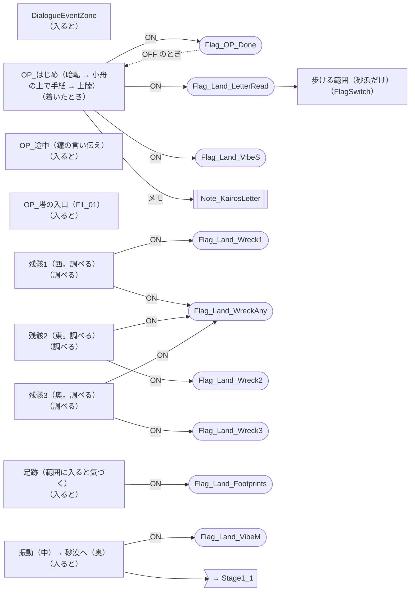

# Stage1_0 の仕掛けの流れ（自動）

Tools > 手順書 > 仕掛けの流れ図を作り直す で作る。直接直さない。四角＝物（きっかけ）、丸＝フラグ、六角＝持ち物、平行四辺形＝仕掛けの状態。赤＝条件がそろわない。

## 注意
- なし

## 図

## 表
| 物 | きっかけ | 条件 | 結果 |
|---|---|---|---|
| DialogueEventZone | 入ると | なし | （会話・演出だけ） |
| OP_はじめ（暗転 → 小舟の上で手紙 → 上陸） | 着いたとき | Flag_OP_Done が OFF | Flag_Land_LetterRead ON、Flag_Land_VibeS ON、Flag_OP_Done ON、メモ Note_KairosLetter |
| OP_途中（鐘の言い伝え） | 入ると | なし | （会話・演出だけ） |
| OP_塔の入口（F1_01） | 入ると | なし | （会話・演出だけ） |
| 歩ける範囲（砂浜だけ） | FlagSwitch | Flag_Land_LetterRead | （表示が変わる） |
| 残骸1（西。調べる） | 調べる | なし | Flag_Land_Wreck1 ON、Flag_Land_WreckAny ON |
| 残骸2（東。調べる） | 調べる | なし | Flag_Land_Wreck2 ON、Flag_Land_WreckAny ON |
| 残骸3（奥。調べる） | 調べる | なし | Flag_Land_Wreck3 ON、Flag_Land_WreckAny ON |
| 足跡（範囲に入ると気づく） | 入ると | なし | Flag_Land_Footprints ON |
| 振動（中）→ 砂漠へ（奥） | 入ると | なし | Flag_Land_VibeM ON、→ Stage1_1 |
