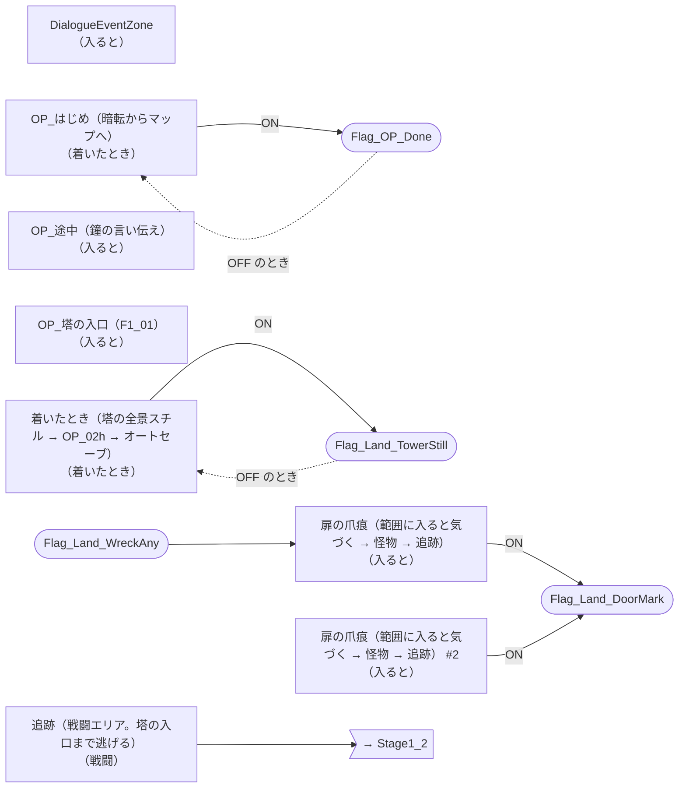

# Stage1_1 の仕掛けの流れ（自動）

Tools > 手順書 > 仕掛けの流れ図を作り直す で作る。直接直さない。四角＝物（きっかけ）、丸＝フラグ、六角＝持ち物、平行四辺形＝仕掛けの状態。赤＝条件がそろわない。

## 注意
- なし

## 図

## 表
| 物 | きっかけ | 条件 | 結果 |
|---|---|---|---|
| DialogueEventZone | 入ると | なし | （会話・演出だけ） |
| OP_はじめ（暗転からマップへ） | 着いたとき | Flag_OP_Done が OFF | Flag_OP_Done ON |
| OP_途中（鐘の言い伝え） | 入ると | なし | （会話・演出だけ） |
| OP_塔の入口（F1_01） | 入ると | なし | （会話・演出だけ） |
| 着いたとき（塔の全景スチル → OP_02h → オートセーブ） | 着いたとき | Flag_Land_TowerStill が OFF | Flag_Land_TowerStill ON |
| 追跡（戦闘エリア。塔の入口まで逃げる） | 戦闘 | なし | → Stage1_2 |
| 扉の爪痕（範囲に入ると気づく → 怪物 → 追跡） | 入ると | Flag_Land_WreckAny | Flag_Land_DoorMark ON |
| 扉の爪痕（範囲に入ると気づく → 怪物 → 追跡） #2 | 入ると | なし | Flag_Land_DoorMark ON |
