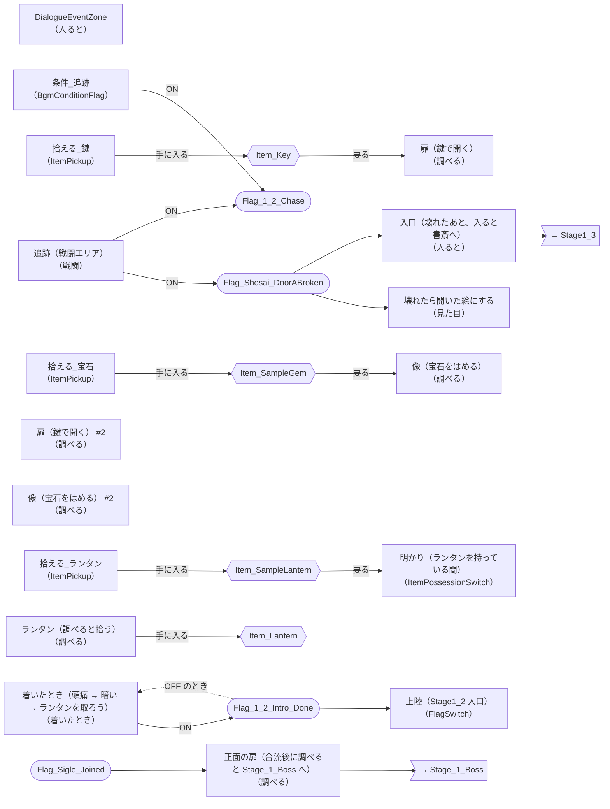

# Stage1_2 の仕掛けの流れ（自動）

Tools > 手順書 > 仕掛けの流れ図を作り直す で作る。直接直さない。四角＝物（きっかけ）、丸＝フラグ、六角＝持ち物、平行四辺形＝仕掛けの状態。赤＝条件がそろわない。

## 注意
- なし

## 図

## 表
| 物 | きっかけ | 条件 | 結果 |
|---|---|---|---|
| DialogueEventZone | 入ると | なし | （会話・演出だけ） |
| 条件_追跡 | BgmConditionFlag | なし | Flag_1_2_Chase ON |
| 拾える_鍵 | ItemPickup | なし | 手に入る Item_Key |
| 拾える_宝石 | ItemPickup | なし | 手に入る Item_SampleGem |
| 拾える_ランタン | ItemPickup | なし | 手に入る Item_SampleLantern |
| 扉（鍵で開く） | 調べる | 持ち物 Item_Key | （会話・演出だけ） |
| 扉（鍵で開く） #2 | 調べる | なし | （会話・演出だけ） |
| 像（宝石をはめる） | 調べる | 持ち物 Item_SampleGem | （会話・演出だけ） |
| 像（宝石をはめる） #2 | 調べる | なし | （会話・演出だけ） |
| 明かり（ランタンを持っている間） | ItemPossessionSwitch | 持ち物 Item_SampleLantern | （表示が変わる） |
| ランタン（調べると拾う） | 調べる | なし | 手に入る Item_Lantern |
| 追跡（戦闘エリア） | 戦闘 | なし | Flag_Shosai_DoorABroken ON、Flag_1_2_Chase ON |
| 壊れたら開いた絵にする | 見た目 | Flag_Shosai_DoorABroken | （表示が変わる） |
| 入口（壊れたあと、入ると書斎へ） | 入ると | Flag_Shosai_DoorABroken | → Stage1_3 |
| 着いたとき（頭痛 → 暗い → ランタンを取ろう） | 着いたとき | Flag_1_2_Intro_Done が OFF | Flag_1_2_Intro_Done ON |
| 正面の扉（合流後に調べると Stage_1_Boss へ） | 調べる | Flag_Sigle_Joined | → Stage_1_Boss |
| 上陸（Stage1_2 入口） | FlagSwitch | Flag_1_2_Intro_Done | （表示が変わる） |
