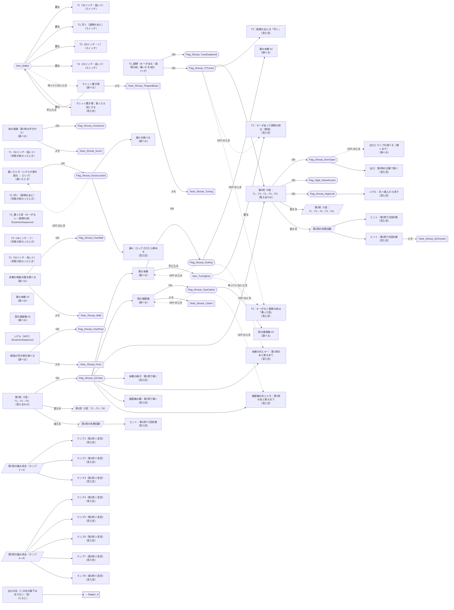

# Stage1_3 の仕掛けの流れ（自動）

Tools > 手順書 > 仕掛けの流れ図を作り直す で作る。直接直さない。四角＝物（きっかけ）、丸＝フラグ、六角＝持ち物、平行四辺形＝仕掛けの状態。赤＝条件がそろわない。

## 注意
- なし

## 図

## 表
| 物 | きっかけ | 条件 | 結果 |
|---|---|---|---|
| 着いたとき（シグルが扉を殴る → ロック） | 着いたとき | Flag_Shosai_DoorsLocked が OFF | Flag_Shosai_DoorsLocked ON |
| 出口の先（この先の廊下はまだない：仮） | 入ると | なし | → Stage1_4 |
| 出口とランプを調べる（開くまで） | 調べる | Flag_Shosai_DoorOpen が OFF | （会話・演出だけ） |
| T1（32インチ・低いド） | 状態が変わったとき | なし | （会話・演出だけ） |
| T1（32インチ・低いド） | スイッチ | 持ち物 Item_Mallet | （会話・演出だけ） |
| T2_叩く（調律のあと） | 状態が変わったとき | なし | （会話・演出だけ） |
| T2_叩く（調律のあと） | スイッチ | 持ち物 Item_Mallet | （会話・演出だけ） |
| T2_濁った音（キーがない・調律の前） | ExamineSequence | なし | （会話・演出だけ） |
| T2_調律（キーがある・調律の前。輪＋E を3回） | ペグ | なし | Flag_Shosai_TuneExplained ON、Flag_Shosai_T2Tuned ON、メモ Note_Shosai_Tuning |
| T3（26インチ・ソ） | 状態が変わったとき | なし | （会話・演出だけ） |
| T3（26インチ・ソ） | スイッチ | 持ち物 Item_Mallet | （会話・演出だけ） |
| T4（23インチ・高いド） | 状態が変わったとき | なし | （会話・演出だけ） |
| T4（23インチ・高いド） | スイッチ | 持ち物 Item_Mallet | （会話・演出だけ） |
| 机の楽譜（第1問の手がかり） | 調べる | なし | Flag_Shosai_ClueScore ON、メモ Note_Shosai_Score |
| マレット置き場 | 調べる | Item_Mallet を持っていない | 手に入る Item_Mallet、メモ Note_Shosai_TimpaniBasic |
| 東の本棚 | 調べる | Flag_Shosai_Q1Clear、Flag_Shosai_GotKey が OFF | Flag_Shosai_GotKey ON、手に入る Item_TuningKey |
| 東の本棚 #2 | 調べる | Flag_Shosai_GotKey | （会話・演出だけ） |
| 東の本棚 #3 | 調べる | なし | （会話・演出だけ） |
| 西の譜面箱 | 調べる | Flag_Shosai_Q1Clear、Flag_Shosai_ClueCipher が OFF | Flag_Shosai_ClueCipher ON、メモ Note_Shosai_Cipher |
| 西の譜面箱 #2 | 調べる | Flag_Shosai_ClueCipher | （会話・演出だけ） |
| 西の譜面箱 #3 | 調べる | なし | （会話・演出だけ） |
| シグル（NPC） | ExamineSequence | なし | （会話・演出だけ） |
| 本棚の側板の傷を調べる | 調べる | なし | Flag_Shosai_ClueWall ON、メモ Note_Shosai_Wall |
| 絨毯の叩き跡を調べる | 調べる | なし | Flag_Shosai_ClueFloor ON、メモ Note_Shosai_Floor |
| 扉A を調べる | 調べる | Flag_Shosai_DoorsLocked | （会話・演出だけ） |
| 第1問（3音：T1→T3→T4） | 答え合わせ | なし | Flag_Shosai_Q1Clear ON、変える 第1問（3音：T1→T3→T4）、変える 第1問の失敗回数 |
| 第2問（5音：T1→T3→T2→T3→T4） | 答え合わせ | Flag_Shosai_Q1Clear、Flag_Shosai_T2Tuned | Flag_Shosai_DoorOpen ON、Flag_Sigle_NameKnown ON、Flag_Shosai_SigleLeft ON、変える 第2問（5音：T1→T3→T2→T3→T4）、変える 第2問の失敗回数 |
| T2：調律のあとは「叩く」 | 見た目 | Flag_Shosai_T2Tuned | （表示が変わる） |
| T2：キーがあって調律の前は「調律」 | 見た目 | Flag_Shosai_T2Tuned が OFF、持ち物 Item_TuningKey | （表示が変わる） |
| T2：キーがなく調律の前は「濁った音」 | 見た目 | Flag_Shosai_T2Tuned が OFF、Item_TuningKey を持っていない | （表示が変わる） |
| ランプ1（第1問 1 音目） | 見た目 | 仕掛け 第1問の進み具合（ランプ1〜3） | （表示が変わる） |
| ランプ2（第1問 2 音目） | 見た目 | 仕掛け 第1問の進み具合（ランプ1〜3） | （表示が変わる） |
| ランプ3（第1問 3 音目） | 見た目 | 仕掛け 第1問の進み具合（ランプ1〜3） | （表示が変わる） |
| ランプ4（第2問 1 音目） | 見た目 | 仕掛け 第2問の進み具合（ランプ4〜8） | （表示が変わる） |
| ランプ5（第2問 2 音目） | 見た目 | 仕掛け 第2問の進み具合（ランプ4〜8） | （表示が変わる） |
| ランプ6（第2問 3 音目） | 見た目 | 仕掛け 第2問の進み具合（ランプ4〜8） | （表示が変わる） |
| ランプ7（第2問 4 音目） | 見た目 | 仕掛け 第2問の進み具合（ランプ4〜8） | （表示が変わる） |
| ランプ8（第2問 5 音目） | 見た目 | 仕掛け 第2問の進み具合（ランプ4〜8） | （表示が変わる） |
| 扉A：ロックされたら閉める | 見た目 | Flag_Shosai_DoorsLocked | （会話・演出だけ） |
| 出口：第2問の正解で開く | 見た目 | Flag_Shosai_DoorOpen | （表示が変わる） |
| シグル：先へ進んだら消す | 見た目 | Flag_Shosai_SigleLeft | （表示が変わる） |
| マレット置き場：取ったら空にする | 見た目 | 持ち物 Item_Mallet | （表示が変わる） |
| 本棚の格子：第1問で開く | 見た目 | Flag_Shosai_Q1Clear | （表示が変わる） |
| 本棚の光とキー：第1問のあと取るまで | 見た目 | Flag_Shosai_Q1Clear、Flag_Shosai_GotKey が OFF | （表示が変わる） |
| 譜面箱の鍵：第1問で開く | 見た目 | Flag_Shosai_Q1Clear | （表示が変わる） |
| 譜面箱の光とメモ：第1問のあと取るまで | 見た目 | Flag_Shosai_Q1Clear、Flag_Shosai_ClueCipher が OFF | （表示が変わる） |
| ヒント：第1問で2回失敗 | 見た目 | 仕掛け 第1問の失敗回数 | （会話・演出だけ） |
| ヒント：第2問で3回失敗 | 見た目 | 仕掛け 第2問の失敗回数 | （会話・演出だけ） |
| ヒント：第2問で5回失敗 | 見た目 | 仕掛け 第2問の失敗回数 | メモ Note_Shosai_Q2Answer |
