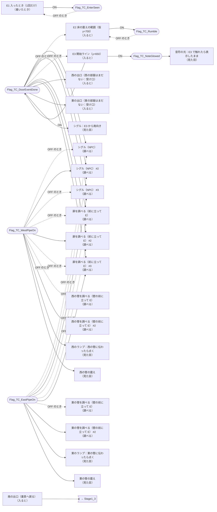

# Stage1_4 の仕掛けの流れ（自動）

Tools > 手順書 > 仕掛けの流れ図を作り直す で作る。直接直さない。四角＝物（きっかけ）、丸＝フラグ、六角＝持ち物、平行四辺形＝仕掛けの状態。赤＝条件がそろわない。

## 注意
- なし

## 図

## 表
| 物 | きっかけ | 条件 | 結果 |
|---|---|---|---|
| E1 入ったとき（1回だけ） | 着いたとき | Flag_TC_EnterSeen が OFF | Flag_TC_EnterSeen ON |
| シグル（NPC） | 調べる | Flag_TC_DoorEventDone、Flag_TC_WestPipeOn が OFF、Flag_TC_EastPipeOn が OFF | （会話・演出だけ） |
| シグル（NPC） #2 | 調べる | Flag_TC_DoorEventDone、Flag_TC_WestPipeOn、Flag_TC_EastPipeOn が OFF | （会話・演出だけ） |
| シグル（NPC） #3 | 調べる | Flag_TC_DoorEventDone、Flag_TC_WestPipeOn が OFF、Flag_TC_EastPipeOn | （会話・演出だけ） |
| E2 床の震えの範囲（仮 y=700） | 入ると | Flag_TC_Rumble が OFF、Flag_TC_DoorEventDone が OFF | Flag_TC_Rumble ON |
| E3 開始ライン（y=650） | 入ると | Flag_TC_DoorEventDone が OFF | Flag_TC_NoteGlowed ON、Flag_TC_DoorEventDone ON |
| 扉を調べる（前に立って E） | 調べる | Flag_TC_DoorEventDone、Flag_TC_WestPipeOn が OFF、Flag_TC_EastPipeOn が OFF | （会話・演出だけ） |
| 扉を調べる（前に立って E） #2 | 調べる | Flag_TC_DoorEventDone、Flag_TC_WestPipeOn、Flag_TC_EastPipeOn が OFF | （会話・演出だけ） |
| 扉を調べる（前に立って E） #3 | 調べる | Flag_TC_DoorEventDone、Flag_TC_WestPipeOn が OFF、Flag_TC_EastPipeOn | （会話・演出だけ） |
| 西の管を調べる（壁の前に立って E） | 調べる | Flag_TC_WestPipeOn が OFF | （会話・演出だけ） |
| 西の管を調べる（壁の前に立って E） #2 | 調べる | Flag_TC_WestPipeOn | （会話・演出だけ） |
| 東の管を調べる（壁の前に立って E） | 調べる | Flag_TC_EastPipeOn が OFF | （会話・演出だけ） |
| 東の管を調べる（壁の前に立って E） #2 | 調べる | Flag_TC_EastPipeOn | （会話・演出だけ） |
| 南の出口（書斎へ戻る） | 入ると | なし | → Stage1_3 |
| 西の出口（西の部屋はまだない：受け口） | 入ると | Flag_TC_DoorEventDone | （会話・演出だけ） |
| 東の出口（東の部屋はまだない：受け口） | 入ると | Flag_TC_DoorEventDone | （会話・演出だけ） |
| 音符の光：E3 で触れたら表示したまま | 見た目 | Flag_TC_NoteGlowed | （表示が変わる） |
| 西のランプ：西の管に伝わったら点く | 見た目 | Flag_TC_WestPipeOn | （表示が変わる） |
| 東のランプ：東の管に伝わったら点く | 見た目 | Flag_TC_EastPipeOn | （表示が変わる） |
| 西の管の震え | 見た目 | Flag_TC_WestPipeOn | （表示が変わる） |
| 東の管の震え | 見た目 | Flag_TC_EastPipeOn | （表示が変わる） |
| シグル：E3 から南向き | 見た目 | Flag_TC_DoorEventDone | （表示が変わる） |
