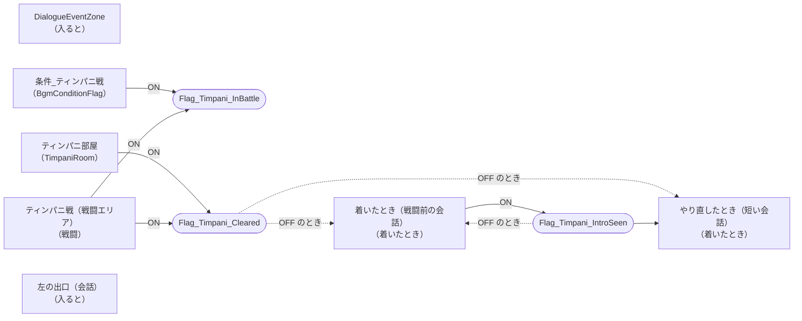

# Stage_1_Boss の仕掛けの流れ（自動）

Tools > 手順書 > 仕掛けの流れ図を作り直す で作る。直接直さない。四角＝物（きっかけ）、丸＝フラグ、六角＝持ち物、平行四辺形＝仕掛けの状態。赤＝条件がそろわない。

## 注意
- なし

## 図

## 表
| 物 | きっかけ | 条件 | 結果 |
|---|---|---|---|
| DialogueEventZone | 入ると | なし | （会話・演出だけ） |
| 条件_ティンパニ戦 | BgmConditionFlag | なし | Flag_Timpani_InBattle ON |
| ティンパニ部屋 | TimpaniRoom | なし | Flag_Timpani_Cleared ON |
| ティンパニ戦（戦闘エリア） | 戦闘 | なし | Flag_Timpani_Cleared ON、Flag_Timpani_InBattle ON |
| 着いたとき（戦闘前の会話） | 着いたとき | Flag_Timpani_Cleared が OFF、Flag_Timpani_IntroSeen が OFF | Flag_Timpani_IntroSeen ON |
| やり直したとき（短い会話） | 着いたとき | Flag_Timpani_Cleared が OFF、Flag_Timpani_IntroSeen | （会話・演出だけ） |
| 左の出口（会話） | 入ると | なし | （会話・演出だけ） |
